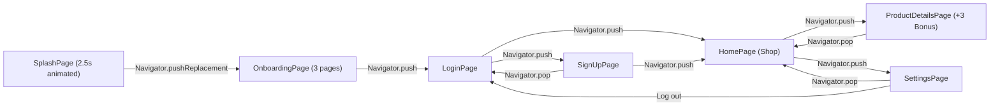

# VoltStore (`voltstore-flutter-midterm`)

> **VoltStore — A bilingual (English / Arabic RTL) Flutter tech & gadgets shopping app with Material 3 Light & Dark theming, animated splash, 3-page onboarding, reusable custom widgets, and product details.**
>
> Built for **Mobile App Development with Flutter · Fall 2026 (Midterm Project)** — Supervised by **Eng. Monther Ibrahim and Muhammad, M.Sc.**

---

## Table of Contents

1. [Overview & Key Features](#overview--key-features)
2. [Screen-by-Screen Navigation Flow](#screen-by-screen-navigation-flow)
3. [Design System & Localization](#design-system--localization)
4. [Project Structure](#project-structure)
5. [Packages Used](#packages-used)
6. [Midterm Rubric Checklist (30 + 3 Bonus Marks)](#midterm-rubric-checklist-30--3-bonus-marks)
7. [Getting Started & Running the App](#getting-started--running-the-app)
8. [Running Static Analysis & Automated Tests](#running-static-analysis--automated-tests)

---

## Overview & Key Features

**VoltStore** (فولت ستور) is a complete multi-screen Flutter UI and navigation project built strictly using the course fundamentals (Lectures 1–12 & 19) — **no Provider or external state management package**, relying cleanly on `setState` and constructor callbacks.

- **Animated Splash Screen**: Branded gradient backdrop with custom VoltStore logo, tagline, loading indicator, and `flutter_animate` transitions (`fadeIn`, `scale`, `shimmer`, `slideY`) lasting 2.5 seconds before opening Onboarding.
- **3-Page Interactive Onboarding**: Built with `introduction_screen`, featuring 3 custom local illustrations, localized titles & descriptions, custom pill dot indicators, **Skip / Next / Get Started** controls, and quick Theme/Language toggles in the header.
- **Login & Sign Up Pages**: Built completely from reusable `AppTextField` (with show/hide password eye toggle) and `AppButton` widgets inside `SafeArea` + `SingleChildScrollView` + `Wrap` so the keyboard and narrow screens never cause overflow stripes.
- **Interactive Shop Home Page**: Displays a personalized greeting hero banner, 6-tile **Categories** (`GridView.count`) with live `setState` filtering, and a 2-column **Featured Gadgets** catalog (`GridView.builder`).
- **Bonus Product Details Page (+3 Marks)**: Smooth `Hero` image animation from the product grid into a rich details page displaying the product image, category badge, star rating, title, price, warranty badge, full localized description, and an interactive **Add to Cart** `SnackBar`.
- **Working Settings Page**:
  - **Dark Mode Switch** (`SwitchListTile`) wired to `MyApp`'s `_themeMode` state via `onThemeChanged` callback — updates every screen instantly.
  - **Arabic / English Switcher** (`LanguageButton`) powered by `easy_localization` — switches language, persists user preference, and automatically mirrors the entire UI to RTL in Arabic.
- **100% Offline Local Assets**: All 10 visual assets (brand logo, 3 onboarding illustrations, and 6 studio gadget images) are bundled in `assets/images/`.

---

## Screen-by-Screen Navigation Flow



| Route Transition | Navigation Method | Data Passed via Constructor |
|---|---|---|
| `SplashPage` → `OnboardingPage` | `Navigator.pushReplacement` | `onThemeChanged` |
| `OnboardingPage` → `LoginPage` | `Navigator.push` | `onThemeChanged` |
| `LoginPage` ⇄ `SignUpPage` | `Navigator.push` / `Navigator.pop` | `onThemeChanged` |
| `LoginPage` / `SignUpPage` → `HomePage` | `Navigator.push` | `userName`, `onThemeChanged` |
| `HomePage` → `ProductDetailsPage` | `Navigator.push` | `product` |
| `HomePage` → `SettingsPage` | `Navigator.push` | `userName`, `onThemeChanged` |
| `SettingsPage` (Log out) → `LoginPage` | `Navigator.pushAndRemoveUntil` | `onThemeChanged` |

---

## Design System & Localization

### Theme Architecture (`lib/theme/app_theme.dart`)
- Built from a single Material 3 seed color: **Deep Indigo (`#4338CA`)** paired with **Electric Cyan** (`secondary`) and **Coral** (`tertiary`) accents.
- One helper function `buildTheme(Brightness brightness)` generates both `theme` (Light) and `darkTheme` (Dark).
- Global `InputDecorationThemeData`, `ElevatedButtonThemeData`, `TextButtonThemeData`, `CardThemeData`, and `AppBarTheme` keep spacing, typography, and corner radii consistent across every screen.
- **Zero hard-coded `Colors.*`** appear in any page or custom widget — every widget reads `Theme.of(context).colorScheme` and `Theme.of(context).textTheme`.

### Bilingual Localization & RTL (`assets/translations/`)
- Full English ([`en.json`](assets/translations/en.json)) and Arabic ([`ar.json`](assets/translations/ar.json)) nested JSON dictionaries covering all 7 screens, product catalog items, categories, tooltips, and `SnackBar` messages.
- Uses `context.tr('group.key')` and `namedArgs` inside `build()` so every screen rebuilds immediately when switching languages.
- Strict RTL mirroring using `AlignmentDirectional`, `EdgeInsetsDirectional`, and `PositionedDirectional`.
- Includes `CFBundleLocalizations` (`en`, `ar`) in `ios/Runner/Info.plist`.

---

## Project Structure

```text
midterm_shop_app/
├── assets/
│   ├── images/
│   │   ├── logo.png
│   │   ├── onboarding_1.png
│   │   ├── onboarding_2.png
│   │   ├── onboarding_3.png
│   │   ├── prod_camera.png
│   │   ├── prod_drone.png
│   │   ├── prod_headphones.png
│   │   ├── prod_keyboard.png
│   │   ├── prod_smartwatch.png
│   │   └── prod_speaker.png
│   └── translations/
│       ├── ar.json
│       └── en.json
├── lib/
│   ├── main.dart                     # EasyLocalization init & MyApp ThemeMode setState
│   ├── models/
│   │   └── product.dart              # Product data model & VoltStore catalog
│   ├── pages/
│   │   ├── splash_page.dart          # Animated 2.5s splash screen
│   │   ├── onboarding_page.dart      # 3-page IntroductionScreen onboarding
│   │   ├── login_page.dart           # Login form using AppTextField & AppButton
│   │   ├── sign_up_page.dart         # Sign up form reusing AppTextField & AppButton
│   │   ├── home_page.dart            # Categories GridView.count + Products GridView.builder
│   │   ├── product_details_page.dart # Bonus (+3) product details with Hero animation
│   │   └── settings_page.dart        # Dark mode SwitchListTile + EN/AR LanguageButton
│   ├── theme/
│   │   └── app_theme.dart            # Centralized Light & Dark Material 3 theme builder
│   └── widgets/
│       ├── app_button.dart           # Reusable full-width ElevatedButton
│       ├── app_text_field.dart       # Reusable TextField with password visibility toggle
│       ├── category_tile.dart        # Reusable selectable category card
│       ├── language_button.dart      # Reusable EN / العربية toggle button
│       ├── product_card.dart         # Reusable product grid card with Hero & rating pill
│       └── theme_button.dart         # Reusable Light / Dark icon button
├── test/
│   └── widget_test.dart              # End-to-end flow, dark mode & Arabic RTL widget test
└── pubspec.yaml
```

---

## Packages Used

Only the 3 packages specified in the midterm project requirements (curated on [Flutter Gems](https://fluttergems.dev/)):

| Package | Version | Purpose | Course Lecture |
|---|---|---|---|
| `introduction_screen` | `^5.0.1` | 3-page onboarding flow with Skip, Next, Done, and dots indicator | Lecture 19 |
| `easy_localization` | `^3.0.8` | English & Arabic JSON localization, live switching, RTL support, and persistence | Lecture 11 |
| `flutter_animate` | `^4.5.2` | Declarative animations for the splash screen and smooth screen/card entrances | Lecture 19 |

---

## Midterm Rubric Checklist (30 + 3 Bonus Marks)

- [x] **Splash screen** — logo & app name shown for 2.5 seconds, then opens Onboarding
- [x] **3 onboarding pages** — built with `introduction_screen`, featuring images, titles, descriptions, Skip, Next, and Done
- [x] **Login & Sign up pages** — built with reusable custom `AppTextField` and `AppButton` widgets, scrollable with keyboard open
- [x] **Home page** — clean shop UI with `GridView.count` categories and `GridView.builder` products
- [x] **Settings page** — working Dark mode switch and Arabic / English language toggle
- [x] **Navigation** — `Navigator.push` / `pop` between all screens with working Back navigation
- [x] **No Provider or state management package** — strictly `setState` and constructor callbacks
- [x] **Bonus (+3 marks)** — tapping any product opens `ProductDetailsPage` with photo, name, price, and description
- [x] **Clean folder structure** — pages in `lib/pages/`, custom widgets in `lib/widgets/`, theme in `lib/theme/`
- [x] **Verified in English & Arabic (RTL)** and **Light & Dark mode** with zero errors or overflow

---

## Getting Started & Running the App

### Prerequisites
- Flutter SDK (Dart `^3.13.5`)
- Android Studio / VS Code with Flutter & Dart plugins
- Android Emulator, iOS Simulator, or physical device

### Setup & Run
```bash
# 1. Clone the repository
git clone https://github.com/<your-username>/voltstore-flutter-midterm.git
cd voltstore-flutter-midterm

# 2. Fetch dependencies
flutter pub get

# 3. Run the app
flutter run
```

> **Note:** After editing `assets/translations/en.json` or `ar.json`, always perform a **Hot Restart** (`Shift + R`) so `easy_localization` reloads the updated JSON files.

---

## Running Static Analysis & Automated Tests

```bash
# Run Dart / Flutter static analyzer (expected: No issues found!)
flutter analyze

# Run the end-to-end widget test suite
flutter test
```

The test in [`test/widget_test.dart`](test/widget_test.dart) verifies the complete user journey:
1. `SplashPage` auto-navigates after 2.5s to `OnboardingPage`.
2. Skipping onboarding opens `LoginPage`; navigating to `SignUpPage` and tapping Back returns to `LoginPage`.
3. Logging in with an email opens `HomePage` with the personalized greeting.
4. Tapping a product opens the bonus `ProductDetailsPage` and pops back cleanly.
5. Opening `SettingsPage` toggles **Dark Mode** (`Brightness.dark`) and switches to **Arabic** (`TextDirection.rtl`).
